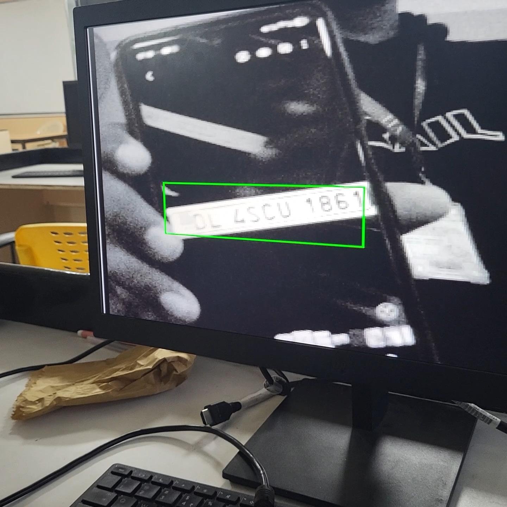
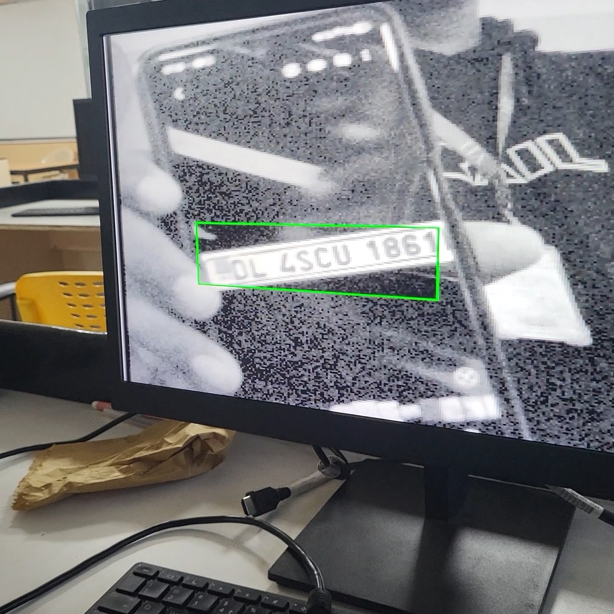

# AUTOMATIC_NUMBERPLATE_DETECTION
# Automatic Number Plate Detection and Low-Light Enhancement on FPGA

## How it works

1. **Capture** - `ov7670_capture_y` keeps only the Y (luminance) bytes of the camera's YUV422 stream and writes a 320x240, 8-bit image into `buf_in`.
2. **Snapshot** - a key press freezes one full frame for processing, and an untouched copy is kept in `buf_orig`.
3. **Plate localisation** - `plate_enhance` finds a bright level (85th percentile), computes Sobel-X edges on bright candidate pixels with an adaptive threshold, and builds row and column edge profiles. `peak_finder` locates the dense band in each profile, which gives the plate box.
4. **Enhancement** - the plate region gets contrast-limited histogram equalisation through a 256-entry LUT. The rest of the frame is gamma-boosted (`gamma_lut`) or left raw.
5. **Display** - `vga_timing` reads the buffers at 25 MHz (640x480 @ 60 Hz, each pixel shown 2x2) and overlays the green plate box. Processing takes about 14-16 ms per snapshot.

The block diagram is in `BLOC_DIAGRAM.jpeg`.

## Source files

| File | Purpose |
|------|---------|
| `top_ov7670_vga.v` | Top level: camera, frame buffers, processor, VGA, keys/switches, LEDs |
| `plate_enhance.v` | Core FSM: plate localisation and ROI histogram equalisation |
| `peak_finder.v` | Finds the dense band in a 1-D edge profile (used for rows and columns) |
| `gamma_lut.v` | 256-entry low-light gamma table |
| `ov7670_capture_y.v` | Captures the Y channel from the camera into a 320x240 buffer |
| `ov7670_controller.v` | Camera configuration, XCLK generation |
| `ov7670_registers.v` | OV7670 register table (YUV422, low-light settings) |
| `i2c_sender.v` | SCCB (I2C-like) transmitter |
| `dp_ram.v` | Simple dual-port RAM used for all buffers, profiles and the LUT |
| `vga_timing.v` | VGA timing, frame-buffer read, test pattern, box overlay coordinates |
| `sig_activity.v` | Debug activity detector for the camera signals |
| `pins.tcl` | DE2-115 pin assignments |

## Hardware

- Terasic DE2-115 board
- OV7670 camera module on the GPIO header (SIOC, SIOD, VSYNC, HREF, PCLK, XCLK, D0-D7, RESET, PWDN; exact pins are in `pins.tcl`)
- VGA monitor connected to the board's VGA port

## Build and run

1. Create a Quartus Prime project for the EP4CE115F29C7 with `top_ov7670_vga` as the top-level entity and add all `.v` files.
2. Source `pins.tcl` (Tools > Tcl Scripts) to apply the pin assignments.
3. Compile and program the board.
4. Connect the camera and monitor, then use the keys and switches below.

## Controls

| Control | Function |
|---------|----------|
| `KEY[0]` | Re-send the camera configuration |
| `KEY[1]` | **Snapshot**: grab the next full frame and process it |
| `KEY[2]` | Back to live preview |
| `KEY[3]` | Re-process the held snapshot (after changing switches) |
| `SW[0]` | Up: show original snapshot. Down: show enhanced result |
| `SW[1]` | Hide the plate box |
| `SW[2]` | VGA colour-bar test pattern |
| `SW[3]` | Leave the non-plate area raw (no gamma boost) |
| `SW[4]` | Edge detection on raw Y instead of gamma-boosted Y |
| `SW[5]` | Global equalisation of the whole frame (for comparison) |
| `SW[17:14]` | All down: adaptive edge threshold. Otherwise fixed threshold = 16 x `SW[17:14]` |

## LED status

| LED | Meaning |
|-----|---------|
| `LEDG[0]` | Camera configuration done |
| `LEDG[1]` | Live preview |
| `LEDG[2]` | Processing |
| `LEDG[3]` | Result held |
| `LEDG[4]` | Plate found |
| `LEDG[5..8]` | Activity on PCLK, HREF, VSYNC and the data bus |

## Bench test without a camera

Set the parameter `USE_TEST_IMAGE = 1` in `top_ov7670_vga` and point `TEST_IMAGE_FILE` at a hex image file. `buf_in` is then pre-loaded, and pressing `KEY[1]` runs the full pipeline. The processing arithmetic is written to match the software reference model `ref_model.py`.

## Results

| Original snapshot | Enhanced result |
|:-:|:-:|
|  |  |

The plate is boxed in green in both images. The enhanced image equalises the plate region and gamma-boosts the rest of the frame, which also amplifies sensor noise in dark areas. Set `SW[3]` up to leave the background raw.

## Report

The full project report is in `anpr_project_report.pdf`.
